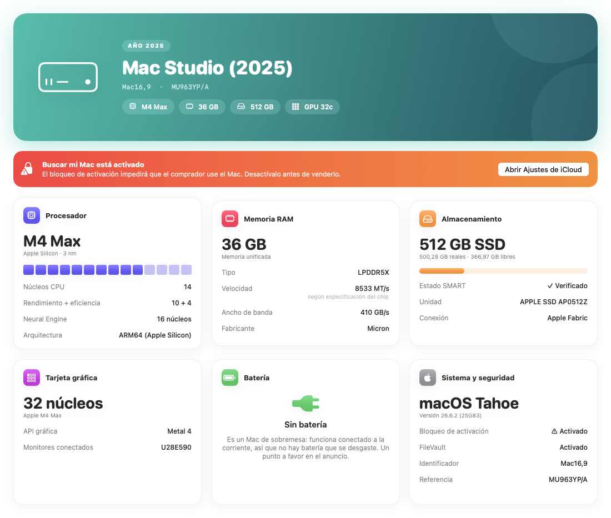
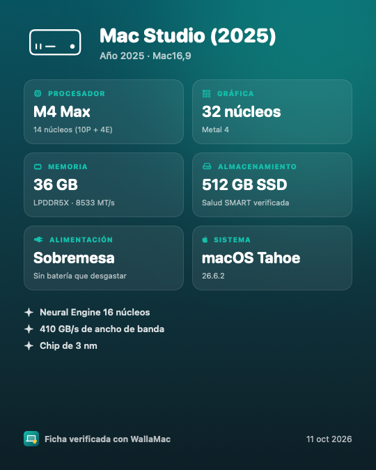

# WallaMac

App nativa para macOS que reúne toda la información de tu Mac que importa para venderlo de segunda mano (Wallapop, Vinted, eBay…) y te prepara el anuncio.



## Qué hace

- **Ficha técnica completa:** modelo comercial y año, identificador y referencia, procesador (núcleos de rendimiento y eficiencia, Neural Engine, proceso de fabricación), RAM (tamaño, tipo, velocidad, ancho de banda), SSD (capacidad, espacio libre, salud SMART), gráfica (núcleos, VRAM, Metal, pantallas) y batería (capacidad, ciclos, estado, mAh).
- **Número de serie camuflable:** visible, parcial (`YP•••••72D`) u oculto, con ajustes separados para el anuncio y para la imagen.
- **Generador de anuncio:** título y descripción listos para pegar, según el estado, los accesorios, el precio y el envío.
- **Imagen para el anuncio:** exporta un PNG de 1080×1350 con la ficha.
- **Lista "Antes de vender":** detecta el bloqueo de activación (Buscar mi Mac), la salud del disco y de la batería, y te guía con el resto (cerrar sesión de iCloud, borrar el Mac…).



## Descargar

**[⬇️ Descargar WallaMac.zip](https://github.com/danielperis/wallamac/releases/latest/download/WallaMac.zip)** · macOS 14 o posterior · Apple Silicon e Intel

1. Descomprime el zip y arrastra **WallaMac** a la carpeta Aplicaciones.
2. La primera vez, macOS te avisará de que no puede verificar al desarrollador (la app no está notarizada por Apple). Para abrirla:
   - Haz doble clic en WallaMac y cierra el aviso.
   - Ve a **Ajustes del Sistema › Privacidad y seguridad**, baja hasta el mensaje sobre WallaMac y pulsa **Abrir igualmente**.
   - Confirma con tu contraseña o Touch ID. A partir de ahí se abre con normalidad.

   Si lo prefieres, desde Terminal:

   ```bash
   xattr -dr com.apple.quarantine /Applications/WallaMac.app
   ```

## Compilar desde el código


Necesita macOS 14 o posterior y las Command Line Tools de Xcode (`xcode-select --install`).

```bash
./build.sh
```

Genera `build/WallaMac.app` (binario universal para Apple Silicon e Intel). Arrástrala a Aplicaciones.

## Notas

- Los datos se leen en local con `system_profiler`, `ioreg`, `diskutil` y `sysctl`. No se envía nada a ningún sitio.
- En Apple Silicon macOS no informa de la velocidad de la RAM. La velocidad y el ancho de banda salen de las especificaciones públicas de cada chip.
